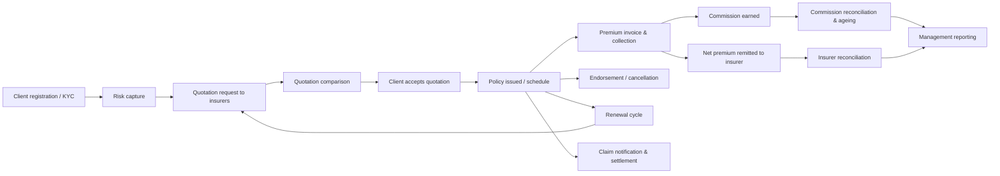
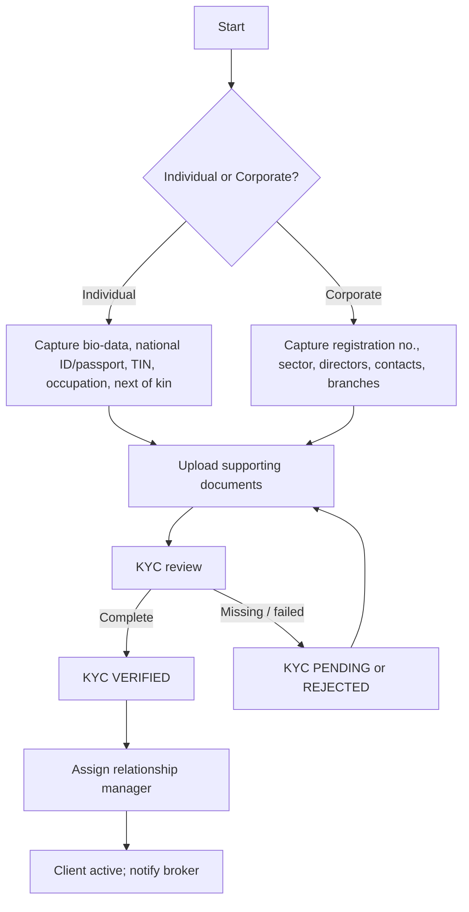
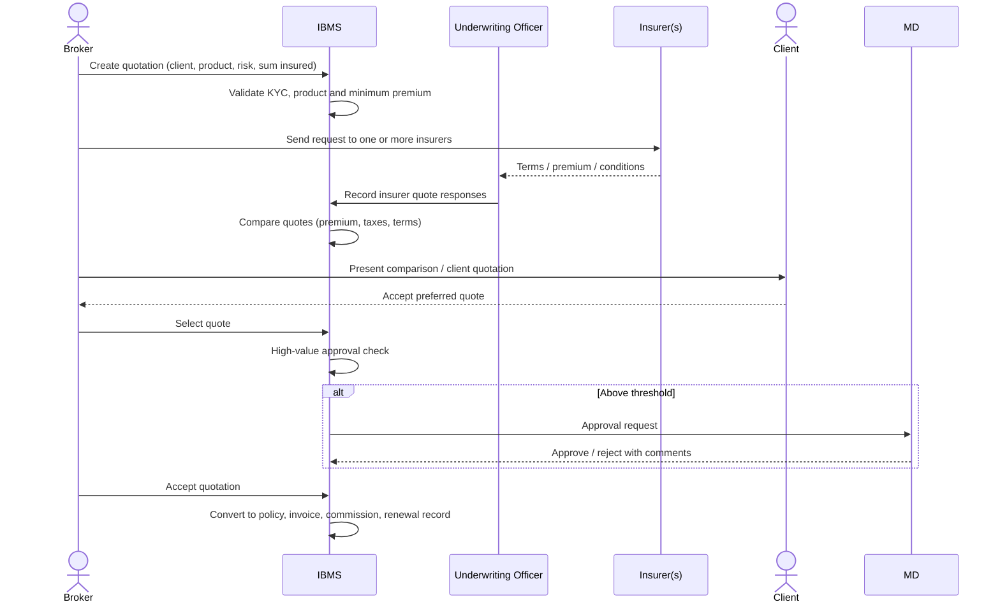
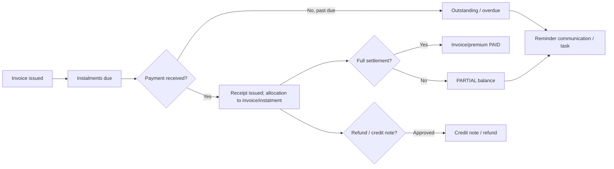
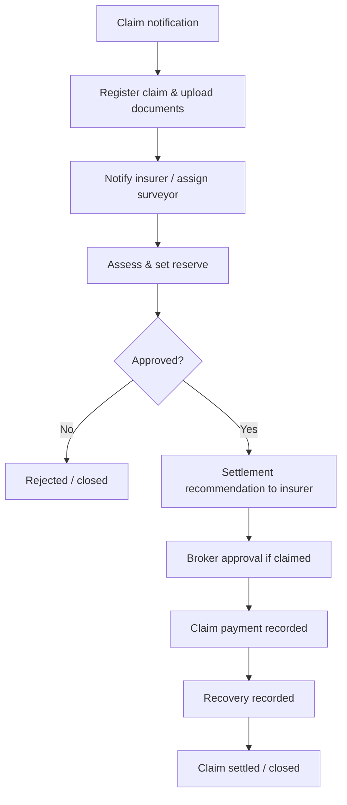

# IBMS — Business Process Analysis and Workflows

Version 1.0 · Prepared for management review

## 1. Purpose and scope

This document analyses standard insurance brokerage operations and defines the
processes automated by the Insurance Brokerage Management System (IBMS). The
brokerage acts as an intermediary between clients (individuals and corporates) and
insurers. It does not underwrite risk; it captures risk, obtains terms, places
business, collects premium, earns commission, services claims and renewals, and
remits net premium to insurers.

In scope:

- Client (CRM) and KYC management
- Insurer, insurance class and product registers
- Risk register and motor insurance details
- Multi-insurer quotations and comparison
- Policy issuance, endorsements, cancellations and renewals
- Premium billing/collection, receipts, credit/debit notes
- Commission earning, reconciliation and ageing
- Insurer remittances
- Claims notification, reserving, settlement and recovery
- Documents, communications, tasks and approvals
- Dashboards, reports, audit trail and user administration

Out of scope (future integrations): direct insurer policy APIs, payment-gateway
automated reconciliation, SMS/email gateway delivery guarantees, e-signature,
customer self-service portal, regulatory returns.

## 2. Actors and departments

| Actor / department | Primary responsibility |
| --- | --- |
| System Administrator | Users, roles, branches, configuration, audit integrity |
| Managing Director | Oversight, high-value approvals, executive reporting |
| Operations Manager | Day-to-day operations, workflow escalation, operational KPIs |
| Branch Manager | Branch P&L, branch approvals, branch staff supervision |
| Broker / Relationship Manager | Client acquisition, risk capture, quotation placement, renewals |
| Underwriting Officer | Product/insurer terms, quotation responses, policy schedules |
| Claims Officer | Claim notification, surveyor liaison, reserving, settlement |
| Finance Officer | Premium collection, receipts, commissions, remittances, reconciliations |
| Customer Service Officer | Client onboarding data, documents, communication, tasks |
| Auditor | Read-only assurance, audit trail, compliance reports |

## 3. Core end-to-end process

## 4. Detailed workflows

### 4.1 Client registration and KYC

Rules:
- Client number auto-generated (`CLI-YYYY-####`). National ID and registration number
  are indexed for duplicate detection.
- A client cannot be quoted until KYC is `VERIFIED` (configurable control; the system
  flags but does not hard-block while KYC is pending, to allow pipeline capture).
- All document versions are retained; only the current version is shown by default.

### 4.2 Risk capture

1. Broker creates a risk record linked to the client, with category (motor, fire,
   marine, liability, life, etc.), location, description, asset details and previous
   claims.
2. Motor risks capture vehicle registration, chassis, engine, make, model, year,
   value, driver and usage, plus logbook upload.
3. Photographs, valuation/inspection reports and supporting documents are uploaded.
4. Risk status moves `OPEN → UNDER_REVIEW → CLOSED` when placed or abandoned.

### 4.3 Quotation management

Rules:
- Quotation number auto-generated (`QT-YYYY-####`).
- Statuses: `DRAFT → SENT → QUOTES_RECEIVED → SELECTED → ACCEPTED` (or `DECLINED`,
  `EXPIRED`). Validity dates are mandatory; expired quotations cannot be accepted.
- Multiple insurer responses are retained for comparison and audit.
- Quotations above the configured high-value threshold require approval before
  acceptance.

### 4.4 Policy issuance

1. On quotation acceptance the system creates:
   - policy with unique number (`POL-YYYY-####`),
   - premium invoice and instalment schedule (single or instalments),
   - commission accrual at policy/product rate,
   - renewal reminder record at 90/60/30/14/7 days,
   - audit entries and an optional approval record.
2. Underwriting attaches the policy schedule and certificate.
3. Policy status: `PENDING → ACTIVE → EXPIRED / LAPSED / CANCELLED`.

### 4.5 Endorsements and cancellations

- Endorsement types: addition, deletion, amendment, cancellation, reinstatement.
- Premium adjustments recalculate commission and create a debit/credit note.
- Endorsements above threshold require Operations/Branch Manager approval.
- Cancellation computes pro-rata refund, requires approval, and reverses commission.

### 4.6 Premium collection

Rules:
- Payment methods: cash, cheque, bank transfer, mobile money, card, other.
- Receipts are immutable once confirmed; reversals create an audit record.
- Overpayments create a client credit balance available for allocation or refund.
- Refunds and credit terms require approval.

### 4.7 Commission management

- Commission rate precedence: product rate → insurer/class agreement → manual override
  (approval required).
- Commission is earned when premium is received (or at policy inception if the
  brokerage operates on accrual basis — configurable); the seed uses **earned on
  policy activation** and status moves to `PAID` when the insurer pays.
- Ageing buckets: 0–30, 31–60, 61–90, 91–180, 180+ days.
- Reconciliation matches commission statements/remittances to policies.

### 4.8 Insurer remittances

1. Finance groups collected premium by insurer and period.
2. System computes gross premium, brokerage retained, taxes and net payable.
3. Remittance advice is generated (`REM-YYYY-####`) and approved.
4. On payment, status becomes `PAID`; reconciliation ties bank payment to advice.
5. Unreconciled differences are tracked for follow-up.

### 4.9 Claims

Rules:
- Claim number auto-generated (`CLM-YYYY-####`).
- Reserve can be revised; every revision is audited.
- Settlement above threshold requires approval.
- Claim documents and correspondence are version-controlled.

### 4.10 Renewals

- A renewal record is created on policy activation and recalculated nightly.
- Reminder stages: 90, 60, 30, 14 and 7 days before expiry (plus overdue).
- A renewal quotation can be generated from the expiring policy.
- Outcome tracked as `WON`, `LOST` (with reason) or `LAPSED`; lost business feeds reports.
- Expired/lapsed policies are reported daily.

### 4.11 Approvals

Configurable approval thresholds apply to:

| Type | Default trigger | Approver |
| --- | --- | --- |
| High-value quotation | Total premium ≥ 50,000 | Managing Director / Operations Manager |
| Commission override | Rate differs from product rate | Operations Manager |
| Endorsement | Premium adjustment ≥ 10,000 | Branch Manager |
| Premium refund | Any refund | Finance Manager / Managing Director |
| Credit terms | Any credit-term request | Finance Officer / Managing Director |
| Claim settlement | Recommendation ≥ 25,000 | Managing Director |

Each approval captures requester, approver, decision, comments and timestamps.

### 4.12 Documents, communication and tasks

- Documents are attached to clients, risks, quotations, policies, claims and
  invoices with version numbers.
- Communications (email/SMS/call/meeting/letter) are logged against clients and
  related records.
- Tasks are assigned to staff with due dates, priority and status; overdue tasks
  appear on the dashboard.
- Renewal and collection reminders create tasks automatically (nightly job).

### 4.13 Reporting and audit

- Dashboards aggregate active clients, premiums placed, brokerage earned,
  outstanding premium/commission, claims, renewals and business mix.
- Report families: business, financial, claims, operational.
- Every login/logout, create, edit, delete (soft), approval, document upload and
  report generation is written to an append-only audit log.

## 5. Departmental responsibilities and RACI

| Activity | Broker | Underwriting | Finance | Claims | Branch Mgr | Ops Mgr | MD | Auditor |
| --- | --- | --- | --- | --- | --- | --- | --- | --- |
| Client onboarding / KYC | R | C | I | I | A | I | I | I |
| Risk capture | R | C | – | – | A | I | I | I |
| Quotation request | R | C | – | – | A | I | I | I |
| Quote comparison / selection | R | A | – | – | C | I | I | I |
| High-value approval | C | C | – | – | C | A | A | I |
| Policy issuance | R | A | I | – | I | I | I | I |
| Premium collection | C | – | R/A | – | I | I | I | I |
| Commission reconciliation | I | – | R/A | – | I | A | I | I |
| Insurer remittance | – | – | R/A | – | I | A | I | I |
| Claim notification | C | – | – | R | I | A | I | I |
| Claim settlement | – | – | C | R | C | A | A | I |
| Renewal follow-up | R | C | – | – | A | I | I | I |
| Reporting | I | I | R | R | R | R | A | I |
| User/role administration | – | – | – | – | – | I | A | I |

R = responsible, A = accountable/approver, C = consulted, I = informed.

## 6. Key business rules

1. Unique identifiers: client number, policy number, quotation number, claim number,
   receipt number, invoice number, remittance number, endorsement number.
2. Dates: policy start < end; quotation valid-from < valid-to; payment date cannot
   precede invoice issue date.
3. Money is stored as `Decimal(14,2)`; commission rates as `Decimal(5,2)` percentage.
4. Tax is stored separately from premium; total = premium + taxes.
5. Deleting master data is soft (deactivation) where financial history exists.
6. Segregation of duties: the creator of an approval request cannot approve it.
7. All state transitions are validated server-side and audited.
8. Branch isolation: branch users see their branch; group roles see all branches.
9. KYC-verified clients only may be placed (warning state otherwise).
10. Policy commission rate is snapshotted at issuance so later product-rate changes
    do not alter historical financials.

## 7. Non-functional requirements

- **Security**: hashed passwords (bcrypt), JWT expiry, account lockout after repeated
  failures, RBAC, audit trail, encrypted transport in production, secrets in
  environment variables, least-privilege DB user in production.
- **Performance**: paginated APIs, indexed search fields, dashboard aggregation
  queries, target < 500 ms for standard list endpoints on reference data.
- **Availability**: container health checks, restart policy, PostgreSQL persistent
  volume, documented backup/restore.
- **Usability**: responsive layout, keyboard-friendly forms, inline validation,
  clear status badges.
- **Maintainability**: modular backend, typed frontend, shared naming, migrations,
  documented API, consistent error envelope.
- **Compliance**: retention of financial and audit records, data-protection-aligned
  access control, exportable audit reports.
<!-- 2026-11-11T15:06:09Z claims workflow -->
