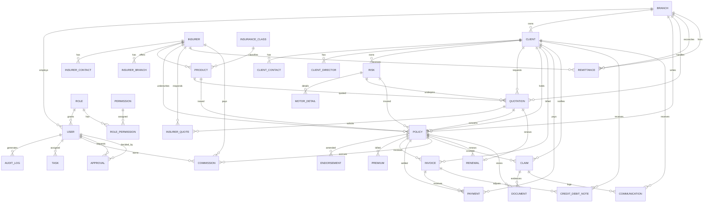
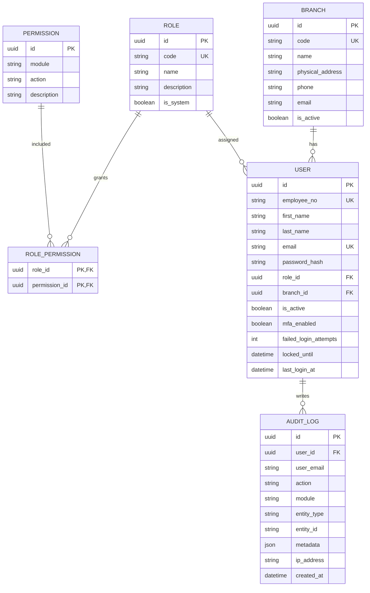
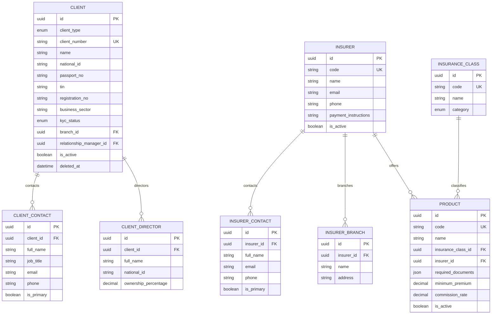
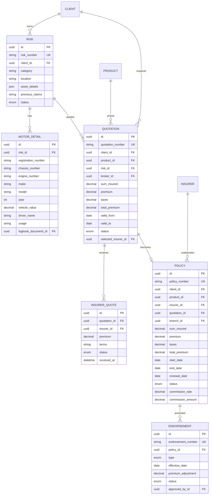
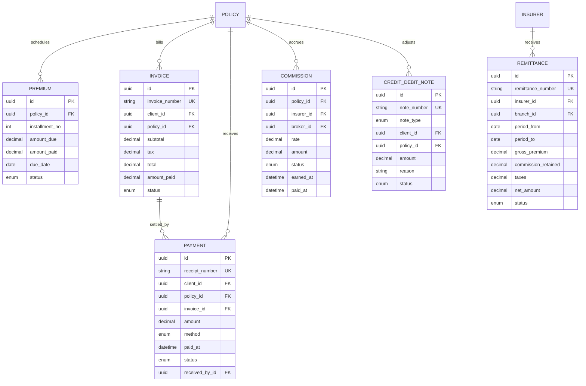
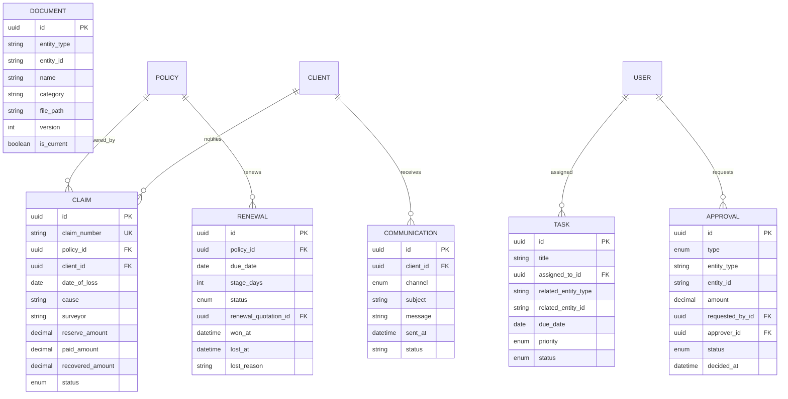

# IBMS — Entity Relationship Diagram (ERD)

Version 1.0 · Prepared for management review

The model is normalised to third normal form. Primary keys are UUIDs generated by
the application/database. Foreign keys enforce referential integrity. Financial
history uses `RESTRICT` on delete; master data is deactivated rather than deleted.
The authoritative implementation is the Django model layer in [`backend/accounts/models.py`](../backend/accounts/models.py), [`backend/crm/models.py`](../backend/crm/models.py), [`backend/operations/models.py`](../backend/operations/models.py), [`backend/finance/models.py`](../backend/finance/models.py), [`backend/claims/models.py`](../backend/claims/models.py) and [`backend/workspace/models.py`](../backend/workspace/models.py).

## 1. High-level ERD

## 2. Authentication and administration

## 3. Client, insurer and product domain

## 4. Risk, quotation and policy domain

## 5. Financial domain

## 6. Claims, renewals and collaboration

## 7. Referential and integrity rules

| Relationship | Cardinality | On delete | Rationale |
| --- | --- | --- | --- |
| Branch → User | 1:N | RESTRICT | Users must retain a branch |
| Role → User | 1:N | RESTRICT | Role in use cannot be removed |
| Client → Risk/Quotation/Policy | 1:N | RESTRICT | Financial history preserved |
| Quotation → InsurerQuote | 1:N | CASCADE | Responses belong to quotation |
| Quotation → Policy | 1:0..1 | SET NULL | Policy survives quotation archive |
| Policy → Premium/Invoice/Commission/Renewal | 1:N | CASCADE | Operational children follow policy |
| Policy → Claim | 1:N | RESTRICT | Claims are legal records |
| Insurer → Remittance | 1:N | RESTRICT | Financial history |
| Document | polymorphic `(entity_type, entity_id)` | CASCADE via app | Shared document store |

## 8. Indexing and evolution notes

- Unique indexes: all business numbers, user email, role code, branch code, product
  code, insurer code, client number, `(role_id, permission_id)`,
  `(quotation_id, insurer_id)`, `(policy_id, installment_no)`, `(policy_id, due_date)`.
- Search indexes: client name, national ID, phone, registration number; policy
  number; claim number; vehicle registration; insurer/class/product codes.
- Status/date indexes support dashboards, renewals and ageing.
- Migration strategy: Django migrations; every schema change is a versioned
  migration generated with `manage.py makemigrations` and applied at container
  start with `manage.py migrate`.
<!-- 2026-11-11T15:06:08Z policy ERD -->
