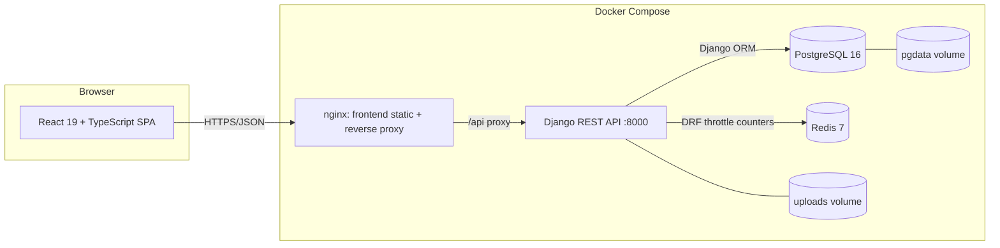

# IBMS — Architecture, Technology Evaluation and Security Design

## 1. Backend technology evaluation

| Criterion | NestJS (Node.js/TypeScript) | Laravel (PHP) | Django (Python) |
| --- | --- | --- | --- |
| Fit with required TypeScript frontend | Excellent — shared language and tooling | Good — separate language | Good — separate language |
| Modularity / large domain | Excellent — modules, DI, guards, interceptors | Strong — mature MVC | Strong — apps, DRF viewsets |
| RBAC and request pipeline | Excellent — custom guards/decorators | Good — middleware, gates, policies | Good — DRF permissions, base viewset mixin |
| Financial decimal handling | Strong via Prisma `Decimal` | Strong via Eloquent casts | Strong via Django `DecimalField` |
| Migration tooling | Prisma Migrate | Excellent — Laravel migrations | Excellent — Django migrations |
| Operational maturity | Good | Good | Excellent — batteries-included admin, auth and ORM |
| Typed API contract | Excellent | Good | Good — serializers with explicit typed fields |

**Selected stack: Django 5.2 + Django REST Framework + PostgreSQL 16.**

Reasons:

1. Django provides a mature ORM, migration system, authentication primitives and
   password validators out of the box, reducing custom security code.
2. DRF serializers give explicit field-level validation and a consistent error
   envelope; the `BaseModelViewSet` supplies RBAC, branch scoping, soft delete and
   audit in one place.
3. Django's migration framework directly satisfies the versioned-database-migration
   deliverable and is applied automatically at container start.
4. PostgreSQL was preferred by the brief and supports decimal money, JSONB for
   flexible risk/asset details, and analytical SQL for ageing and dashboards.
5. Docker images are small and start quickly, simplifying containerised delivery.

Laravel and NestJS remain viable alternatives, but neither improves on the above
for this team and stack. The required React + TypeScript frontend is unchanged.

## 2. System architecture



- The SPA is served by nginx, which also proxies `/api` and `/media` to the backend
  container.
- All state is in PostgreSQL; uploaded documents are on a named volume.
- Configuration is supplied entirely by environment variables.
- Health endpoints (`/api/health/`) are used by Compose health checks.

## 3. Backend app map

```
backend/
├── manage.py
├── ibms/                       settings, URLs, WSGI/ASGI
├── accounts/                   User, Role, Permission, Branch, AuditLog, auth views
├── crm/                        Client, contacts, directors, insurers, classes, products
├── operations/                 Risk, MotorDetail, Quotation, InsurerQuote, Policy,
│                               Endorsement, Renewal + services.py
├── finance/                    Premium, Invoice, Payment, CreditDebitNote,
│                               Commission, Remittance + services.py
├── claims/                     Claim and settlement workflow
├── workspace/                  Document, Communication, Task, Approval
├── reporting/                  dashboard, reports, global search, health
├── common/
│   ├── permissions.py          module:action RBAC permission class
│   ├── pagination.py           {data, meta} envelope
│   ├── exceptions.py           consistent error envelope
│   ├── audit.py                audit log helper
│   ├── numbering.py            transactional business-number generator
│   ├── throttles.py            dedicated login rate limiter
│   ├── testing.py              shared Django test fixtures
│   └── viewsets.py             BaseModelViewSet, soft delete, branch scoping
└── accounts/management/commands/seed.py
```

Domain services keep cross-entity financial logic transactional:

- `operations/services.py::create_policy` creates the policy, premium schedule,
  invoice and commission snapshot.
- `finance/services.py::allocate_payment` allocates a receipt across invoices and
  installments atomically.

## 4. API conventions

- Base path `/api`.
- Success list envelope: `{ data: [...], meta: { page, pageSize, total, totalPages } }`.
- Success item envelope: `{ data: {...} }`.
- Error envelope: `{ statusCode, message, details? }` (validation detail is a
  field-keyed object).
- Auth: `Authorization: Bearer <JWT>`. Access tokens carry the user id; the user,
  role and permission set are loaded server-side on every request.
- Dates are ISO-8601 (`YYYY-MM-DD` for date-only); money is a JSON number with two
  decimals (`COERCE_DECIMAL_TO_STRING = False`).
- Pagination: `?page=1&pageSize=20`.
- Search: `?search=`; ordering: `?ordering=field` or `?ordering=-field`.
- Filtering: resource-specific query parameters, documented in the API reference.
- Actions are POSTs on detail routes, e.g. `POST /api/claims/{id}/settle/`.

## 5. Security design

| Control | Implementation |
| --- | --- |
| Password storage | Django password hasher (PBKDF2-SHA256 by default) with validators |
| Authentication | SimpleJWT access token (12 h default) + refresh token (7 days), server-side permission checks |
| Lockout | `MAX_LOGIN_ATTEMPTS` (default 5) → `LOCK_MINUTES` (default 15) |
| RBAC | Global `IsAuthenticatedAndPermitted`; permission codes are `module:action`; ADMIN bypass |
| Branch scoping | Branch/Broker/Service roles are restricted to their branch on scoped resources |
| Segregation of duties | Endorsement and approval actions reject self-approval |
| Input validation | DRF serializer validation; unknown fields rejected on write serializers |
| HTTP hardening | Django `SecurityMiddleware`, HSTS/secure-cookie settings, clickjacking protection, CSRF for session routes, explicit CORS origins |
| Rate limiting | DRF anonymous/user throttles plus a dedicated per-IP login throttle |
| SQL injection | Django ORM parameterised queries only |
| Upload safety | 20 MB request/upload limit (configurable); files stored outside the code image on a volume |
| Audit | Every mutating operation writes an append-only `audit_logs` row with actor, IP, user agent and action |
| Secrets | Environment variables only; `.env` is git-ignored; `.env.example` documents keys |
| Transport | TLS terminates at the reverse proxy in production (documented) |
| Data protection | Least-privilege roles, soft delete for master data, isolated upload volume |

## 6. Data integrity and financial rules

- Money arithmetic uses Python `Decimal` and PostgreSQL `numeric(14,2)`.
- Business numbers (`CLI-`, `RSK-`, `QT-`, `POL-`, `END-`, `INV-`, `RCT-`,
  `CRN-`/`DBN-`, `REM-`, `CLM-`) are generated transactionally with a row lock.
- Commission snapshots rate and amount on policy creation; later rate changes do not
  rewrite history.
- Receipts, invoices and remittances receive immutable business numbers.
- Payment allocation updates invoice and instalment balances in a single transaction.
- Commission ageing is computed from `earned_at`; unpaid and reconciled states are
  explicit.
- Deletion of financial records is blocked; master data is deactivated.

## 7. Non-functional targets

| Concern | Target |
| --- | --- |
| API list response | < 500 ms for 100k-row tables with indexed search |
| Dashboard | < 1.5 s on reference dataset |
| Availability | Container restart, DB health check, persistent volume |
| Backup | Nightly `pg_dump`; restore procedure in installation docs |
| Observability | Structured logs to stdout, health endpoint, audit trail |
| Accessibility | Semantic HTML, labelled inputs, keyboard-operable dialogs |
| Responsiveness | Desktop-first, usable from 1024 px; collapsible navigation |

## 8. Delivery phases mapping

| Phase | Status in this build |
| --- | --- |
| 1 — Core foundation | Auth, RBAC, users, roles, branches, clients, insurers, products |
| 2 — Brokerage operations | Risks, motor, quotations, policies, endorsements, renewals |
| 3 — Financial | Premiums, invoices, receipts, commissions, remittances, notes |
| 4 — Claims & admin | Claims, documents, communications, tasks, approvals |
| 5 — Reporting | Dashboards, business/financial/claims/operational reports, audit trail |

## 9. Deployment topology

- `db`: PostgreSQL 16, named volume `ibms_pgdata`, health check; exposed on 5434 for
  local inspection only.
- `cache`: Redis 7 for shared DRF throttle counters; internal network only.
- `api`: Django + Gunicorn, waits for DB and Redis, runs migrations, collects static
  files and optionally seeds; named volume `ibms_media`.
- `web`: nginx serving the built SPA and proxying `/api`/`/media`; depends on `api`.
- `.env` controls credentials, ports, JWT lifetimes, lockout, seed password, CORS and
  business thresholds.
- Production hardening checklist is provided in the installation guide.
